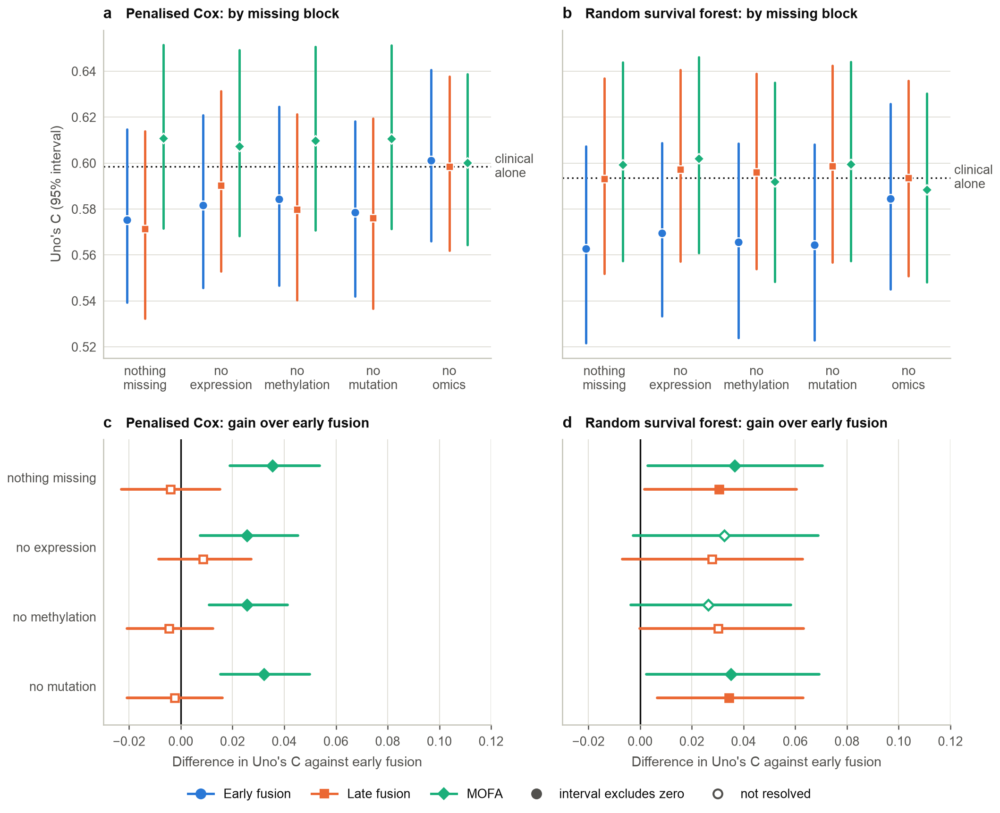
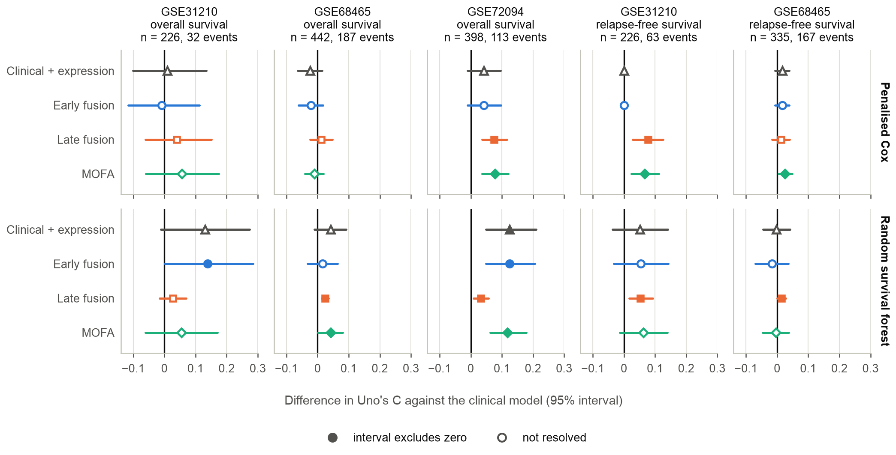
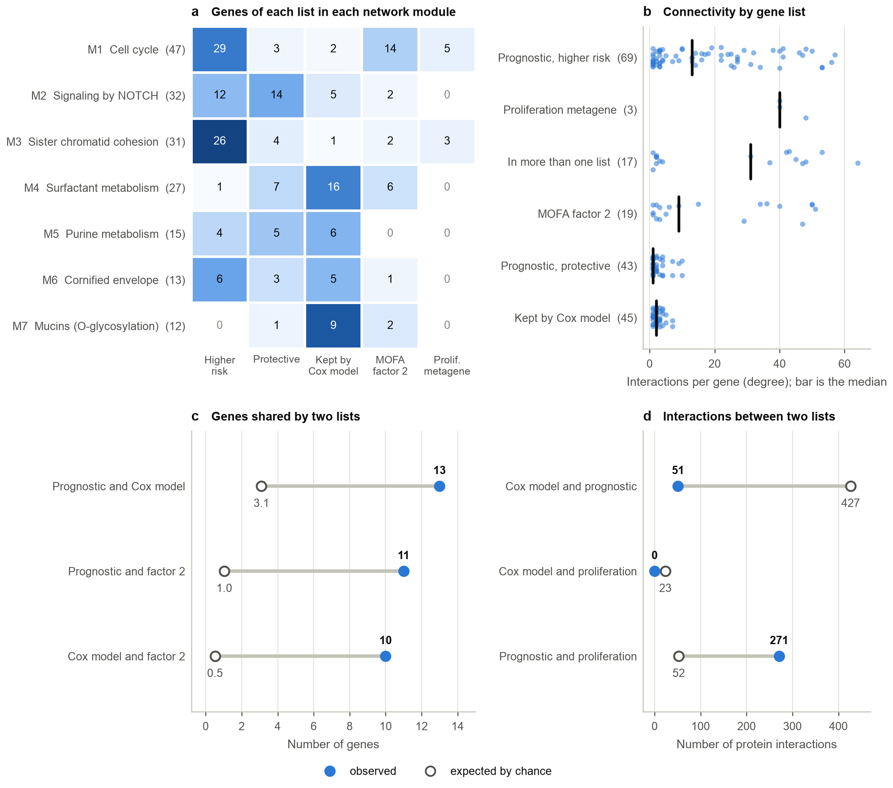
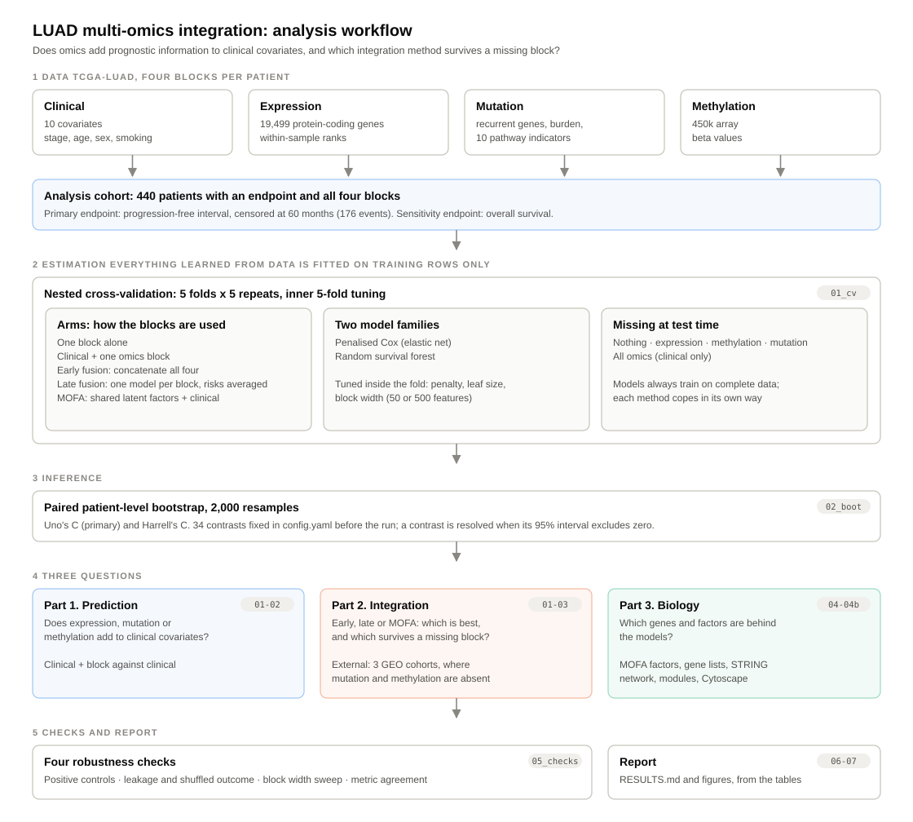
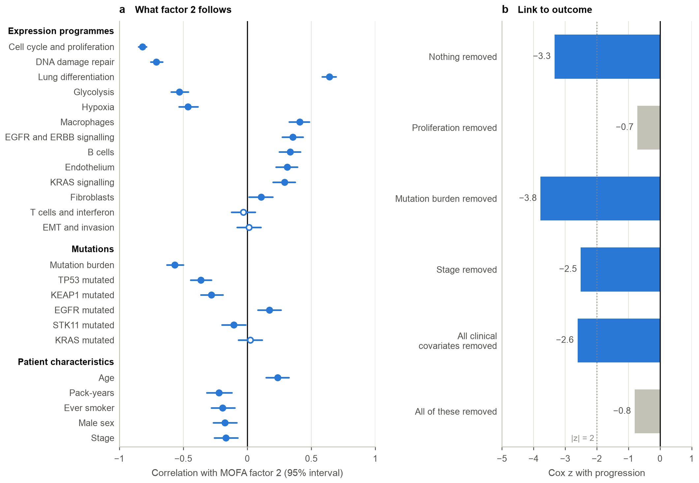

# LUAD multi-omics integration

**Does omics data improve prognosis in lung adenocarcinoma beyond clinical covariates, and which integration method still works when a patient is missing a data type?**

An analysis of 440 TCGA-LUAD patients with four data blocks (clinical, expression, mutation, methylation), three integration methods, two model families and three external cohorts. The plan was fixed in one config file before anything was run.

> **The answer.** Inside TCGA, omics adds nothing to clinical covariates. But *how* the blocks are combined matters: a shared latent-factor model (MOFA) beats simple concatenation, barely notices a missing block, and carries over to external cohorts, where integration does improve on the clinical model.

Full write-up with every figure and table: **[results/REPORT.md](results/REPORT.md)**. Raw generated numbers: [RESULTS.md](RESULTS.md). Data: [doi:10.5281/zenodo.24509337](https://doi.org/10.5281/zenodo.24509337).

## Main findings

Primary endpoint: progression-free interval, 176 events. Metric: Uno's C (0.5 is chance). Intervals: 95%, paired patient-level bootstrap.

| | Finding | Evidence |
|---|---|---|
| 1 | **Omics does not beat clinical covariates.** | Clinical alone 0.598. Adding expression, mutation or methylation changes it by −0.031 to +0.008; none is a resolved gain under either model. |
| 2 | **Concatenating everything makes it worse.** | Early fusion against clinical: −0.023 (−0.045, −0.002) with penalised Cox. |
| 3 | **MOFA beats early fusion under both model families.** | +0.036 (0.019, 0.054) with Cox; +0.037 (0.003, 0.071) with the random survival forest. |
| 4 | **MOFA is robust to a missing block.** | 0.607 to 0.611 with any one omics block removed at test time, against 0.611 with none removed. |
| 5 | **Integration helps in external cohorts.** | Against the clinical model in three GEO cohorts: late fusion better in 6 of 10 cells, MOFA in 5 of 10, neither ever worse. |
| 6 | **Prognostic genes and model genes are different biology.** | Genes prognostic alone are cell-cycle genes (CDK1, CCNA2, TOP2A). The Cox model keeps surfactant and mucin genes (SFTPB, NKX2-1, MUC5B). 51 protein interactions between the two lists against 427 expected. |
| 7 | **One latent factor carries the signal, and it is a proliferation axis.** | MOFA factor 2: Cox z = −3.3. It follows a cell-cycle programme (r = −0.82) with lung differentiation at the other end; with proliferation removed, z = −0.7. The reading of the factor was added after the first run. |

**Not shown, and not claimed:** that MOFA beats clinical covariates alone. It is the only method above the clinical line (0.611 against 0.598), but the difference is +0.012 (−0.003, 0.028).

### The integration result



*Top: discrimination of each method when the test patient is missing nothing, one omics block, or all omics; the dotted line is the clinical model. Bottom: paired gain over early fusion. Filled markers are resolved.*

### External validation



*Models trained on TCGA, applied unchanged to cohorts where mutation and methylation do not exist.*

### Biology



*Risk genes sit in two tightly connected cell-cycle modules; the genes the model keeps sit elsewhere and are sparsely connected.*

### Read these before quoting a number

- Effects are small (0.01 to 0.04) and 176 events is the limit.
- One run, one seed.
- 27 of 34 verdicts agree between Uno's C and Harrell's C; 5 contrasts change sign.
- The network link test does not preserve each gene's number of interactions, so the direction of finding 6 is safe and its size is not.
- External gains mix two things: the method, and an external clinical model with four covariates instead of ten.

## Workflow



## Run it

You need Python 3.13, `make`, about 4 GB of free disk and about 3 hours. It was run and tested on Linux only. The internet is needed for `make setup` and `make data`, and not after that. R and Cytoscape are **not** needed.

```bash
make setup     # once: create .venv and install the pinned packages (about a minute)
make data      # once: download the prepared data from Zenodo and check it (1.5 GB)
make test      # 10 seconds, synthetic data: is the installation sound?
make quick     # 1 minute, real data, tiny settings: does the pipeline run here?
make all       # everything, in order: about 3 hours with 12 workers
make verify    # a second: do your tables match the published ones?
make help      # the individual steps and what they cost
```

`make all` ends with `make verify`, which compares the 19 result tables of your run with the published ones in `tests/reference_tables/` and prints PASS or the difference for each.

**It has been reproduced, twice.** On 23 November 2026 `make all` was rerun in a clean copy with a newly built environment and gave the same numbers. On 24 November the repository was cloned into an empty folder, its results were deleted, the environment was built from the pinned versions, the data came from the archive, and `make all` ran from start to finish in 3 hours with 12 workers: all 19 tables passed `make verify`, and every table, `RESULTS.md`, every source-data file and all 15 figures drawn by Python came out byte for byte or pixel for pixel identical. What is not identical from run to run: the creation date inside the PDF files, and the two pictures exported by the Cytoscape program, which differed in 0.05% of their pixels.

**If a step fails**, the run stops there. Fix the cause and continue with the remaining steps, for example `make biology cytoscape permute checks report cohort figures verify`. Finished steps do not need to be repeated.

**New to the project?** Read "Words used here" below, then `config/config.yaml` (the whole plan, with comments), then the scripts in the order of the table. Each script starts with what it is for, what it reads, what it writes and how long it takes.

### Words used here

| Word | Meaning |
|---|---|
| Block | One kind of data about a patient: clinical, expression (`rna`), mutation or methylation |
| Arm | One way of using the blocks to predict, for example `clinical`, `clinical+rna`, `early`, `late`, `mofa` |
| Early fusion | All blocks joined into one wide table, one model |
| Late fusion | One model per block; their risk scores are averaged |
| MOFA | A method that summarises the omics blocks as a few shared "factors"; the model then uses the factors |
| Scenario | What the test patient is missing: nothing, one omics block, or all omics. Written after `@`, as in `mofa@no_rna` |
| Endpoint | The outcome predicted. PFI, progression-free interval: time until the cancer progresses. OS: overall survival |
| Censored | A patient whose follow-up ended before the event happened; we know only that it had not happened yet |
| Concordance, Uno's C | How often the model ranks two patients in the right order. 0.5 is a coin toss, 1.0 is perfect. Uno's C is a version that corrects for censoring |
| Fold | Cross-validation splits the patients into 5 parts; each part in turn is held out for testing and the model is trained on the rest. Repeated 5 times: 25 folds |
| Nested | Settings of a model are chosen by a second cross-validation inside the training part only, so the test patients never influence them |
| Bootstrap | The patients are redrawn with replacement 2,000 times to see how much a number would move with other patients; this gives the 95% intervals |
| Contrast | A planned comparison, "arm A minus arm B" in Uno's C |
| Resolved | The 95% interval of a contrast does not include zero |
| Leakage | Information from test patients reaching the model during training, which makes results look better than they are |

Each step is one script in `scripts/`, numbered in the order they run:

| Step | Script | Writes |
|---|---|---|
| 1 | `01_cv.py` | `cv_<endpoint>_predictions.parquet`: one risk per fold, model, arm and test patient |
| 2 | `02_bootstrap.py` | `arms_<endpoint>.csv`, `contrasts_<endpoint>.csv`, forest plot |
| 3 | `03_external.py` | `external_arms.csv`, `external_contrasts.csv`, figure |
| 4 | `04_biology.py` | `biology_*.csv` (factors, gene lists, modules, enrichment, network statistics), `network.png`, `results/network/network.graphml` |
| 4b | `04b_cytoscape.py` | Optional. Loads the network into the Cytoscape desktop program, styles it and checks step 4's network statistics against Cytoscape's own; `network_cytoscape_*.png` and `.pdf`, `results/network/network.cys`. Skipped with a message where Cytoscape is not installed |
| 5 | `05_checks.py` | `checks.csv`, `width_sweep.csv` |
| 6 | `06_report.py` | `RESULTS.md`, generated from the tables and never edited by hand |
| 7 | `07_figures.py` | The publication figures in `results/figures/` (`fig*.png`, `fig*.pdf`, the workflow as SVG and PDF, the cohort flow diagram) used by `results/REPORT.md`, and `results/source_data/`: the numbers behind every panel, one CSV per panel |
| 8 | `08_cohort_table.py` | `cohort_characteristics.csv` and `.md`: baseline characteristics of the patients analysed; `cohort_flow.csv`: how 509 patients become 440 |
| 9 | `09_verify.py` | Nothing: compares the tables of this run with `tests/reference_tables/` and prints PASS or the differences |
| 10 | `10_survival_curves.py` | Added after the first run. `survival_curves_<endpoint>.csv`, `survival_groups_<endpoint>.csv`: Kaplan-Meier curves of patients in thirds of out-of-fold predicted risk |
| 11 | `11_factor_biology.py` | Added after the first run. `biology_factor_associations.csv`, `biology_factor_outcome.csv`: what MOFA factor 2 follows, and whether its link to outcome survives removing a simpler variable |

`results/REPORT.md` is the one hand-written results document. Its numbers were checked against the tables of the 22 November 2026 run, which the 23 November rerun reproduced; after a rerun, regenerate `RESULTS.md` and the figures, then update the report's text.

## Added after the first run

The plan in `config/config.yaml` was fixed before anything was run, and the seven findings above come from it. Two things were added on 24 November 2026, after the results were known. They are kept apart, in the configuration under `added_after_first_run` and in section 10 of the report, so that a reader can tell planned from unplanned.

| Addition | What it is | Why it was added | What it does not do |
|---|---|---|---|
| Step 10, survival curves | Kaplan-Meier curves of patients in thirds of out-of-fold predicted risk, for the clinical model and MOFA | A concordance of 0.60 is hard to picture; the curves show it | It compares no arms and adds no contrast. It is a picture of numbers already reported |
| Step 11, what factor 2 is | Correlation of the outcome-linked MOFA factor with marker-gene programmes, driver mutations and clinical covariates | "One factor tracks outcome" said nothing about what the factor is | It is exploratory. Programmes and factor come from the same expression data, so it describes the factor and does not confirm it independently |



*Factor 2 follows proliferation at one end and lung differentiation at the other. Its link to progression disappears when proliferation is removed and stays when mutation burden is removed.*

Nothing else was added: the 34 contrasts, the models, the blocks and the checks are the ones declared in advance.

## Design

**Three parts, fixed before anything was run.**

| Part | Question | Methods |
|---|---|---|
| 1. Prediction | Does expression, mutation or methylation add to clinical covariates? | Penalised Cox, random survival forest, nested cross-validation |
| 2. Integration | Early fusion, late fusion or MOFA: which is best, and which survives a missing block? | The three methods on identical folds, five missing-block scenarios, external GEO cohorts |
| 3. Biology | What are the genes and factors behind the models? | MOFA factors, gene lists, STRING network, modules, enrichment, Cytoscape export |

**Data.** TCGA-LUAD. Four blocks: clinical (10 covariates), expression (19,499 protein-coding genes as within-sample ranks), somatic mutation (recurrent genes, tumour mutation burden, ten pathway indicators) and methylation (450k beta values). A patient enters the cohort only with an endpoint and all four blocks, so every arm is compared on the same patients. Primary endpoint: progression-free interval, censored at 60 months. Sensitivity: overall survival. External: three GEO cohorts (GSE72094, GSE31210, GSE68465).

**Arms.** An arm is a way of using the blocks.

- `clinical`, `rna`, `mutation`, `methylation`: one block.
- `clinical+rna`, `clinical+mutation`, `clinical+methylation`: one block added to clinical.
- `early`: all four blocks concatenated into one model.
- `late`: one model per block; the risks are standardised and averaged, weighted by each block's inner-CV concordance above 0.5.
- `mofa`: MOFA factors learned from the three omics blocks, plus the clinical covariates, into one model.

**Scenarios.** What the test patient is missing: nothing, expression, methylation, mutation, or all three omics blocks. Models are always trained on complete data. `early` fills a missing block with training means; `late` drops that block's model; `mofa` computes the patient's factors from the blocks that are present. External GEO patients have no mutation or methylation data at all, so they are a real case of the two-blocks-missing scenario (`@geo`), not a simulated one.

**Inference.** 5-fold cross-validation repeated 5 times, hyperparameters and block widths tuned in an inner 5-fold loop. Uno's C is the primary metric; Harrell's C is reported beside it. Intervals come from a paired bootstrap that resamples patients once per replicate for the whole cohort, shared by every fold and arm. The contrasts are the list in `config/config.yaml` and nothing else.

**The rule that protects every number.** Anything learned from data (which genes, which probes, which mutated genes, the imputer, the scaler, the MOFA factors, the hyperparameters) is fitted on training rows only. It lives in `src/luad/transforms.py`, and `tests/test_leakage.py` checks it by corrupting every test row and requiring that nothing fitted changes.

**Checks that passed.** Y-linked genes match recorded sex (r = 0.96). A shuffled outcome scores 0.49 to 0.53 across 22 arms. The pairing control is exactly zero on both endpoints. No fixed block width puts omics above clinical.

## Layout

```
config/config.yaml     the whole plan: blocks, models, scenarios, contrasts
src/luad/              the library
  data.py              load and align the four blocks
  transforms.py        fold-internal feature selection and imputation
  models.py            penalised Cox and random survival forest, tuned by inner CV
  integrate.py         late fusion and MOFA (fit, and project new patients)
  cv.py                one outer fold: every arm, every scenario
  bootstrap.py         paired patient-level bootstrap
  external.py          stack TCGA and a GEO cohort into one train/test problem
  biology.py           Cox scores, STRING, network modules, export
scripts/               the eleven steps
tests/                 unit tests on a synthetic cohort; reference_tables/ for `make verify`
prep/                  rebuild data/processed from raw downloads (R and Python)
results/
  REPORT.md            the explained results, with figures
  figures/             publication figures (PNG, PDF) and the workflow (SVG, PDF)
  source_data/         the numbers behind every figure panel, one CSV per panel
  tables/              every number, as CSV and parquet
  network/             Cytoscape session, GraphML, node and edge tables
```

## Things to know

- **MOFA uses a Gaussian likelihood for every view**, including the 0/1 mutation features. This is an approximation; it keeps the projection of a new patient onto the factors in closed form.
- **New patients are projected onto the factors**, not included in the MOFA fit: `Z = (I + sum W'TW)^-1 sum W'T x` over the views the patient has. Training patients go through the same projection, so the model is trained on what it will see.
- **Step 4 uses the STRING database of protein interactions** (string-db.org), but not over the internet: STRING's answers for this analysis are saved in `results/network/string_edges.tsv` and `string_enrichment.tsv` and are read from there. So the network is the same for every reader, whatever STRING publishes later. `--refresh` asks STRING again (only gene symbols are sent); `--offline` forbids any request.
- **Step 4b is optional and drives the Cytoscape desktop program** through its automation port (localhost:1234). If Cytoscape is installed but closed, the script starts it with the `cytoscape` launcher named in `config/config.yaml` and leaves it open with the network loaded; the styles are named "LUAD lists" and "LUAD Cox z". If Cytoscape is not installed, the step prints a message and the run goes on: the network statistics come from step 4, and the Cytoscape pictures in `results/figures/` are already in the repository.
- **DIABLO is not included.** It is a classifier, and using it here would mean turning survival into a yes/no label at one time point. MOFA covers the latent-factor family without that step.
- **`prep/` was carried over from the earlier project** and tested here on 24 November 2026: from the raw files, it rebuilds all 15 prepared files with identical content. See [Data](#data).
- **Figures are built to journal format.** 179 mm wide, Arial 6 to 7 pt, vector PDF with editable text beside every PNG. Colours were checked for colour-vision deficiency, and every method or gene list also has its own marker shape, so the figures read in greyscale. The workflow PDF is written only where Chrome or Chromium is installed; the SVG is always written.
- **Data are not in the repository.** `data/` is ignored by git because the files are large. There are two ways to get them, described under [Data](#data).

## Data

The analysis reads the 14 files of `data/processed` and `data/interim/endpoints.parquet` (1.5 GB together). All of it is derived from public, open-access sources: TCGA-LUAD from the Genomic Data Commons, the TCGA Clinical Data Resource, the MC3 mutation calls, and the GEO series GSE72094, GSE31210 and GSE68465.

1. **Download the prepared data.** One archive, with the exact files the reported numbers were computed from:

   ```bash
   make data
   ```

   The archive is the Zenodo record [doi:10.5281/zenodo.24509337](https://doi.org/10.5281/zenodo.24509337) (`luad-multiomics-data-v1.tar`, 1.5 GB). `make data` downloads it, checks it against `config/data_bundle.sha256` and unpacks it into `data/`. To use a copy kept elsewhere: `make data DATA_URL=<address>`.

2. **Rebuild from the sources** (R and Python). `make download` and `make download-methylation` fetch about 10 GB of raw files; `make prep` then builds the 15 files in about 6 minutes. The R packages are installed by `Rscript prep/00_setup_r.R`.

   What was tested, on 24 November 2026: `make prep`, in an empty copy of the repository, from the raw files downloaded in August 2026. All 15 files came out with exactly the same content as the archive: every value, every label, every column type. Twelve of them differ from the archive byte for byte, because a newer version of the R package that writes the files (arrow 26) lays the same table out differently on disk; the three files written by Python are byte-identical. So this route gives the same data, but not an archive with the same checksum.

   R versions: `renv.lock` records the R 4.3.3 set of packages the files were first made with, in the earlier project. The 24 November test used R 4.6 with newer packages (arrow 26.0.1, maftools 2.28.0) and still gave identical content; `renv.lock` is kept as the record of the original versions, not as a requirement.

   What was not tested: the downloads themselves. They were not repeated, and the sources change with new data releases, so a download made today may differ from the one made in August 2026. For reproducing the reported numbers exactly, use route 1.

## Relation to my MSc dissertation

The dissertation and this project reach the same main answer on different patients with different designs; the numbers are set side by side in [section 11 of the report](results/REPORT.md#11-relation-to-my-msc-dissertation).

This project is a redesign of the question I studied in my MSc Bioinformatics dissertation (University of West London, 2026), with one plan made in advance. It is not the dissertation itself: the cohort, the methods and the numbers here are different. It reuses the dissertation's processed data and three ideas that were tested there: fold-internal transforms, the patient-level paired bootstrap, and the leakage checks. The lncRNA, pathway-score, rank-transform, neural-network and TabPFN experiments were not carried over; the dissertation found that none of them changed the answer.
