# Multi-omics integration for prognosis in lung adenocarcinoma: results report

Run of 22 November 2026. One full pass of the pipeline, one seed. Reruns on 23 and 24 November 2026, the second from a fresh clone with nothing but the code and the data archive, gave the same numbers.

This report explains the results. The complete numbers, generated straight from the tables, are in [RESULTS.md](../RESULTS.md); every figure here is drawn from the same tables by `scripts/07_figures.py` (`make figures`). Each figure is saved as a 300 dpi PNG and a vector PDF in [figures/](figures/), and the numbers behind each panel are in [source_data/](source_data/).

## Contents

1. [Summary](#1-summary)
2. [Workflow](#2-workflow)
3. [Data and cohort](#3-data-and-cohort)
4. [Part 1. Does omics add to clinical covariates?](#4-part-1-does-omics-add-to-clinical-covariates)
5. [Part 2. Which integration method, and what if a block is missing?](#5-part-2-which-integration-method-and-what-if-a-block-is-missing)
6. [External validation in three GEO cohorts](#6-external-validation-in-three-geo-cohorts)
7. [Sensitivity: overall survival](#7-sensitivity-overall-survival)
8. [Part 3. Biology behind the models](#8-part-3-biology-behind-the-models)
9. [Robustness checks](#9-robustness-checks)
10. [Added after the first run](#10-added-after-the-first-run)
11. [Relation to my MSc dissertation](#11-relation-to-my-msc-dissertation)
12. [Limitations](#12-limitations)
13. [Where everything is](#13-where-everything-is)

## 1. Summary

**Question.** In lung adenocarcinoma, does integrating omics data add prognostic information to clinical covariates, and which integration method still works when a patient is missing a block?

**Setting.** 440 TCGA-LUAD patients with clinical, expression, mutation and methylation data; 176 progression events within 60 months. Two model families, 25 cross-validation folds, 34 contrasts fixed before the run.

| # | Finding | Key number | How firm |
|---|---|---|---|
| 1 | Omics does not improve on clinical covariates inside TCGA | Clinical alone: Uno's C 0.598. Best single addition: +0.001 to +0.008 | Firm. No block helps under either model; two additions are measurably worse under Cox |
| 2 | How the blocks are combined matters more than whether they are | MOFA against early fusion: +0.036 (0.019, 0.054) with Cox, +0.037 (0.003, 0.071) with the forest | Supported under both models |
| 3 | MOFA is barely affected by a missing block | 0.607 to 0.611 with any one omics block removed, against 0.611 with none removed (Cox) | Supported under Cox; same direction under the forest |
| 4 | MOFA is the only method above clinical alone, but the gap is not resolved | +0.012 (−0.003, 0.028) | Not established |
| 5 | In external cohorts, integration does help | Late fusion beats the clinical model in 6 of 10 cohort-endpoint-model cells, MOFA in 5 of 10; neither is ever worse | Supported, with a caveat about the weaker external clinical model |
| 6 | Prognostic genes and model genes are different biology | Prognostic genes: cell cycle. Genes kept by the Cox model: surfactant and mucin. 51 protein interactions between the lists against 427 expected | Direction firm, size not |
| 7 | One latent factor tracks outcome, and it is a proliferation axis | MOFA factor 2: Cox z = −3.3. Correlation with a cell-cycle programme −0.82; with that programme removed, z = −0.7 | Nominal, whole-cohort fit. The interpretation was added after the first run (section 10.2) |

**In one sentence.** Adding omics to clinical data does not improve prediction of progression in TCGA-LUAD, but if omics is used, a shared latent-factor model (MOFA) is the safer way to combine it: it beats simple concatenation, loses almost nothing when a block is absent, and transfers to external cohorts.

## 2. Workflow

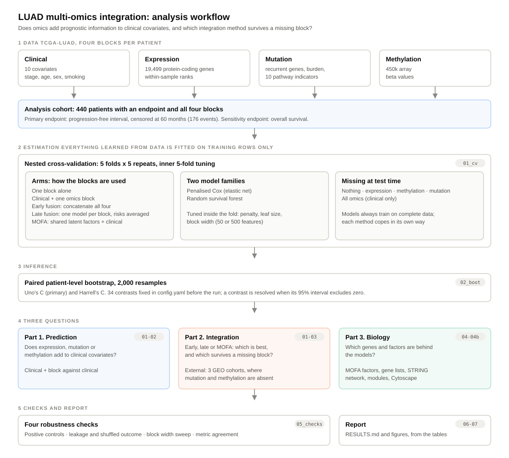

**Figure 1. The analysis from data to report.** Labels on the right of each box are the scripts that run the step. Vector copy: `figures/fig1_workflow.pdf`.

The design has one rule that protects every number: anything learned from data (gene and probe selection, imputation, scaling, MOFA factors, hyperparameters) is fitted on training rows only. A unit test corrupts every test row and checks that nothing fitted changes.

Terms used throughout:

| Term | Meaning |
|---|---|
| Block | One data type: clinical, expression, mutation or methylation |
| Arm | A way of using the blocks, for example `clinical+rna` |
| Early fusion | All four blocks concatenated into one model |
| Late fusion | One model per block; the risks are standardised and averaged, weighted by each block's inner cross-validation performance |
| MOFA | Latent factors learned jointly from the three omics blocks, then modelled together with the clinical covariates |
| Uno's C | Concordance index corrected for censoring. 0.5 is chance, 1.0 is perfect ranking |
| Resolved | The 95% bootstrap interval of a difference excludes zero |
| PFI | Progression-free interval, the primary endpoint |

## 3. Data and cohort

| Item | Value |
|---|---|
| Source | TCGA-LUAD |
| Analysis cohort | 440 patients with an endpoint and all four blocks |
| Primary endpoint | PFI, censored at 60 months: 176 events |
| Sensitivity endpoint | Overall survival |
| Clinical block | 10 covariates |
| Expression block | 19,499 protein-coding genes, within-sample ranks |
| Mutation block | Up to 25 recurrent genes, tumour mutation burden, pathway indicators |
| Methylation block | 450k array beta values |
| External cohorts | GSE31210 (n = 226), GSE68465 (n = 442), GSE72094 (n = 398) |
| Cross-validation | 5 folds, repeated 5 times; inner 5-fold tuning |
| Inference | Paired patient-level bootstrap, 2,000 resamples |

**How the cohort is reached.** Of 509 TCGA-LUAD patients with a usable endpoint, all have clinical covariates, 5 have no expression data, 8 more have no mutation data and 56 more have no methylation data, which leaves 440 (`tables/cohort_flow.csv`).

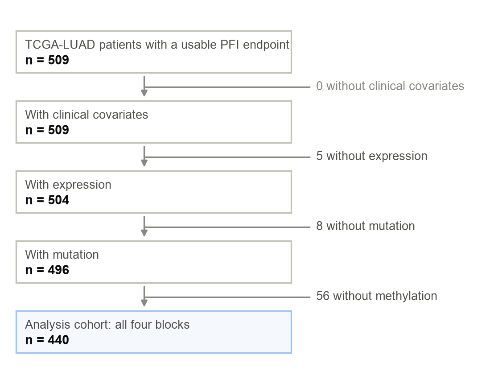

**Supplementary figure. Patients from TCGA-LUAD to the analysis cohort.** The rules are applied in the order shown; each count on the right is the number of patients removed by that rule alone at that point. The same 440 patients are used for both endpoints (176 progression events, 149 deaths within 60 months). Source data: `source_data/figS_cohort_flow_a.csv`.

**Baseline characteristics.** The table below describes the 440 patients that were analysed. "Progressed" means a progression event within 60 months, the same censoring the models use.

| Characteristic | All (n = 440) | Progressed (n = 176) | Censored (n = 264) |
|:--|:--|:--|:--|
| Age at diagnosis, median (IQR) | 66 (59–72) | 66 (59–72) | 65 (58–73) |
| Male | 204 (46.4%) | 81 (46.0%) | 123 (46.6%) |
| Stage I | 239 (54.3%) | 73 (41.5%) | 166 (62.9%) |
| Stage II | 107 (24.3%) | 56 (31.8%) | 51 (19.3%) |
| Stage III | 69 (15.7%) | 32 (18.2%) | 37 (14.0%) |
| Stage IV | 21 (4.8%) | 14 (8.0%) | 7 (2.7%) |
| Never smoker | 62 (14.1%) | 24 (13.6%) | 38 (14.4%) |
| Current smoker | 103 (23.4%) | 38 (21.6%) | 65 (24.6%) |
| Pack-years, median (IQR) | 30 (11–50) | 30 (15–45) | 30 (10–50) |

Stage is the only characteristic that visibly separates the two groups, which fits the later finding that the clinical model does most of the work. Full version: [tables/cohort_characteristics.md](tables/cohort_characteristics.md), written by `scripts/08_cohort_table.py`. Mutation summary (TP53 50.6%, KRAS 29.5%, KEAP1 18.2%; RTK-RAS pathway altered in 87.1%): [tables/table2_mutation_summary.md](tables/table2_mutation_summary.md).

## 4. Part 1. Does omics add to clinical covariates?

**No.** Clinical covariates alone reach a Uno's C of 0.598 with the penalised Cox model and 0.594 with the random survival forest. No omics block, alone or added to clinical, does better.

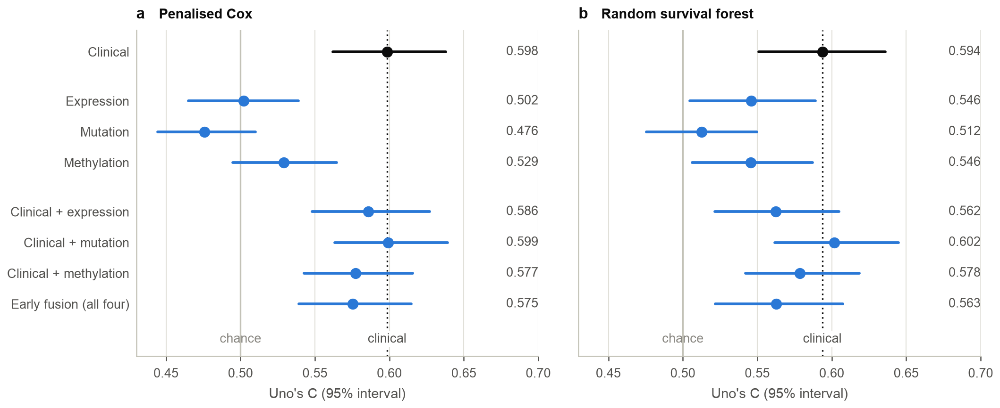

**Figure 2. Discrimination of each arm for progression-free interval.** n = 440 patients, 176 events within 60 months. (a) Penalised Cox. (b) Random survival forest. Points are Uno's C, the mean over 25 test folds (5 folds, 5 repeats); bars are 95% percentile intervals from 2,000 paired patient-level bootstrap resamples. The dotted line is the clinical model; the solid grey line is chance (0.5). Source data: `source_data/fig2_prediction_pfi_ab.csv`.

| Arm | Penalised Cox | Random survival forest |
|:--|:--|:--|
| Clinical | 0.598 (0.562, 0.638) | 0.594 (0.551, 0.636) |
| Expression | 0.502 (0.465, 0.539) | 0.546 (0.505, 0.589) |
| Mutation | 0.476 (0.444, 0.510) | 0.512 (0.476, 0.550) |
| Methylation | 0.529 (0.495, 0.565) | 0.546 (0.506, 0.587) |
| Clinical + expression | 0.586 (0.548, 0.627) | 0.562 (0.521, 0.605) |
| Clinical + mutation | 0.599 (0.563, 0.639) | 0.602 (0.562, 0.645) |
| Clinical + methylation | 0.577 (0.543, 0.616) | 0.578 (0.542, 0.618) |
| Early fusion (all four) | 0.575 (0.539, 0.615) | 0.563 (0.522, 0.607) |

What to read from this:

- **Omics blocks alone are weak.** Under Cox, expression and mutation alone are at chance (0.502 and 0.476). The forest extracts a little more (0.546 for expression and methylation) but stays well below clinical.
- **Adding a block does not help.** The paired differences against clinical range from −0.031 to +0.008. Mutation is the only block that does no harm (+0.001 with Cox, +0.008 with the forest), and neither gain is resolved.
- **Two additions are measurably worse under Cox.** Clinical + methylation: −0.021 (−0.038, −0.004). Early fusion: −0.023 (−0.045, −0.002). Hundreds of weakly informative features dilute ten useful ones.
- **The intervals on single arms are wide** (about ±0.04) because 176 events is a small number. The paired contrasts are much tighter, because both arms are scored on the same resampled patients. Read the contrasts, not the overlap of the bars.

## 5. Part 2. Which integration method, and what if a block is missing?

**MOFA is the best of the three, and the most robust.** Simple concatenation is the worst way to combine the blocks under both model families.

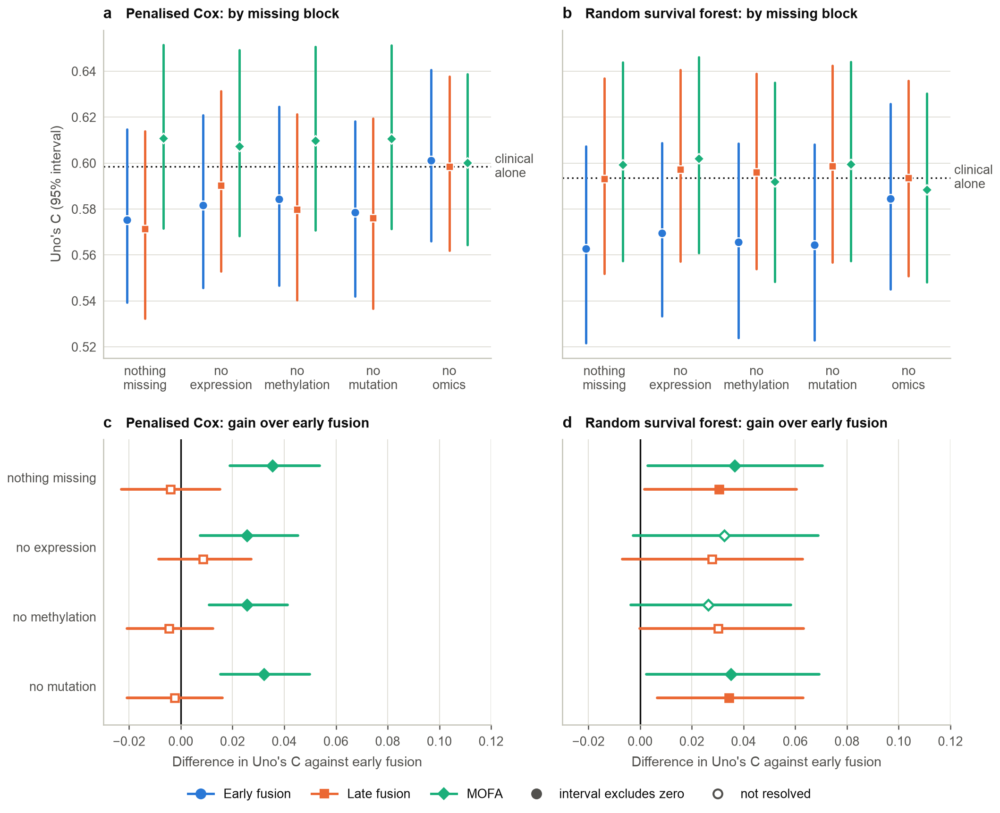

**Figure 3. Integration methods with and without a missing block.** (a, b) Uno's C for each method when the test patient is missing nothing, one omics block, or all omics. The dotted line is the clinical model. (c, d) The paired difference of late fusion and MOFA against early fusion in the same scenario. Early fusion is a blue circle, late fusion an orange square and MOFA a green diamond, here and in Figure 5. Filled markers: the 95% interval excludes zero. n = 440 patients, 176 events; points are means over 25 test folds; intervals are 95% percentile intervals from 2,000 paired patient-level bootstrap resamples. Models are always trained on complete data; the block is removed from the test patient only. Source data: `source_data/fig3_integration_pfi_ab.csv`, `source_data/fig3_integration_pfi_cd.csv`.

**Nothing missing.**

| Contrast | Penalised Cox | Random survival forest |
|:--|:--|:--|
| MOFA − early fusion | **+0.036 (+0.019, +0.054)** | **+0.037 (+0.003, +0.071)** |
| MOFA − late fusion | **+0.039 (+0.016, +0.063)** | +0.006 (−0.016, +0.028) |
| Late − early fusion | −0.004 (−0.023, +0.015) | **+0.030 (+0.002, +0.060)** |
| MOFA − clinical | +0.012 (−0.003, +0.028) | +0.006 (−0.027, +0.038) |
| Late fusion − clinical | −0.027 (−0.057, +0.001) | −0.000 (−0.028, +0.029) |

Bold: resolved.

- **MOFA beats early fusion under both models**, by nearly the same amount (+0.036 and +0.037). This is the most consistent positive result in the study.
- **Late fusion depends on the model family.** It matches MOFA with the forest and is no better than early fusion with Cox.
- **MOFA does not beat clinical alone.** It is the only method that sits above the clinical line (0.611 against 0.598 with Cox), but the interval includes zero. This must not be reported as a gain.

**A block missing at test time.** Models are always trained on complete data. Early fusion fills a missing block with training means, late fusion drops that block's model, and MOFA estimates the patient's factors from the blocks that are present.

| Missing at test | Early | Late | MOFA | Clinical model |
|:--|--:|--:|--:|--:|
| *Penalised Cox* | | | | |
| Nothing | 0.575 | 0.571 | 0.611 | 0.598 |
| Expression | 0.582 | 0.590 | 0.607 | 0.598 |
| Methylation | 0.584 | 0.580 | 0.610 | 0.598 |
| Mutation | 0.579 | 0.576 | 0.611 | 0.598 |
| All omics | 0.601 | 0.598 | 0.600 | 0.598 |
| *Random survival forest* | | | | |
| Nothing | 0.563 | 0.593 | 0.599 | 0.594 |
| Expression | 0.569 | 0.597 | 0.602 | 0.594 |
| Methylation | 0.566 | 0.596 | 0.592 | 0.594 |
| Mutation | 0.564 | 0.599 | 0.599 | 0.594 |
| All omics | 0.585 | 0.594 | 0.589 | 0.594 |

- **MOFA loses almost nothing.** Under Cox it stays between 0.607 and 0.611 whichever single block is removed, and beats early fusion in all three scenarios (+0.026, +0.026, +0.032, all resolved).
- **Under the forest the gains are the same size but less certain.** MOFA and late fusion are +0.026 to +0.035 above early fusion; only the no-mutation scenario is resolved for both.
- **With all omics removed, every method falls back to the clinical model**, as it should (0.585 to 0.601). Late fusion with no omics is the clinical model exactly; this is the pairing control, and its difference is exactly zero.
- **Early fusion improves when blocks are removed** (0.575 with everything, 0.601 with clinical only, under Cox). That is the clearest sign that the concatenated omics features hurt it.

**All 34 contrasts.**

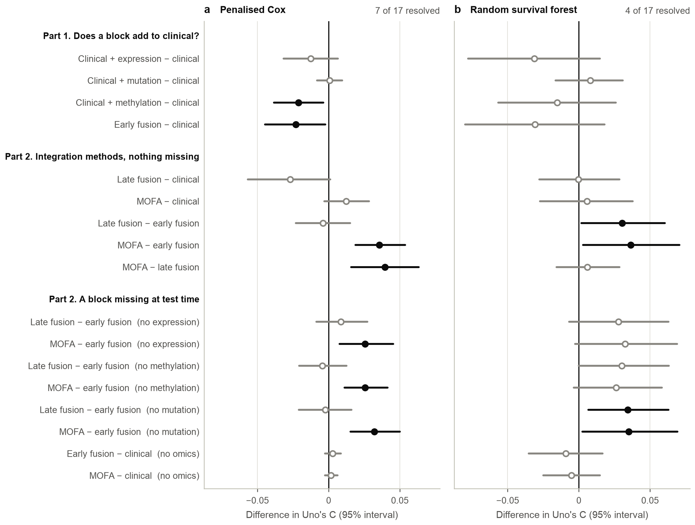

**Figure 4. Every pre-declared contrast for progression-free interval.** (a) Penalised Cox. (b) Random survival forest. Each row is "first arm minus second arm" in Uno's C: 17 contrasts per model family, 34 in all, fixed in `config/config.yaml` before the run. n = 440 patients, 176 events, 25 test folds. Bars are 95% percentile intervals from 2,000 paired patient-level bootstrap resamples; no correction for the number of contrasts is applied. Black, filled: the interval excludes zero (resolved). Grey, open: not resolved. Source data: `source_data/fig4_contrasts_pfi_ab.csv`.

| | Favour first arm | Favour second arm | Not resolved |
|:--|--:|--:|--:|
| PFI (primary), 34 contrasts | 9 | 2 | 23 |
| Overall survival (sensitivity), 34 contrasts | 7 | 1 | 26 |

With 34 contrasts at 95%, about 2 would resolve by chance alone; 11 did. All 9 positive results on PFI are an integration method beating early fusion or late fusion. Both negative results are an omics addition falling below clinical.

## 6. External validation in three GEO cohorts

Models trained on TCGA were applied unchanged to three independent cohorts. These patients have expression and four clinical covariates only, so mutation and methylation are missing for real, not by simulation.

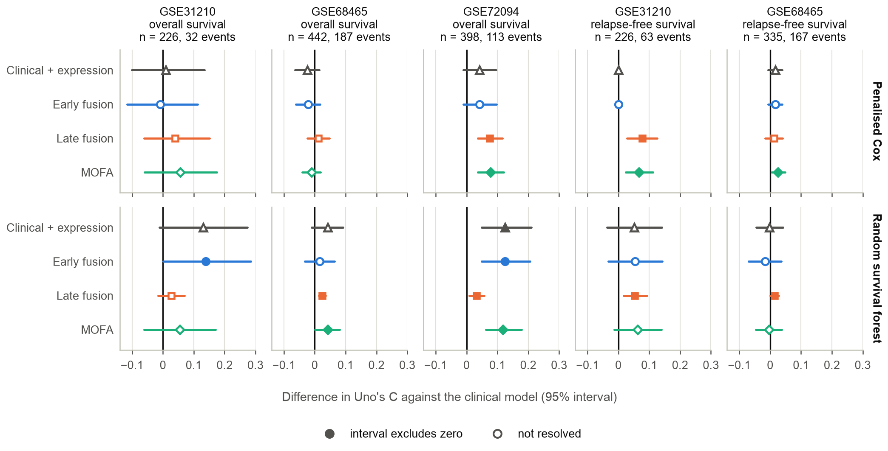

**Figure 5. Gain over the clinical model in external cohorts.** Each panel is one cohort and endpoint; rows are model families. Points are the difference in Uno's C against the clinical model, with 95% percentile intervals from 2,000 paired bootstrap resamples of the external patients. Models are trained once on the 440 TCGA patients and applied unchanged; patients and events of each cohort are given above its panel. The external clinical model has four covariates (age, sex, stage, smoking), not ten. Marker shapes as in Figure 3; filled markers: the interval excludes zero. Source data: `source_data/fig5_external_a.csv`.

| Contrast | First arm better | Not resolved | Second arm better |
|:--|--:|--:|--:|
| Late fusion − clinical | 6 | 4 | 0 |
| MOFA − clinical | 5 | 5 | 0 |
| Early fusion − clinical | 2 | 8 | 0 |
| Clinical + expression − clinical | 1 | 9 | 0 |
| MOFA − early fusion | 1 | 9 | 0 |
| Late − early fusion | 2 | 7 | 1 |
| MOFA − late fusion | 1 | 9 | 0 |

Counts are over 10 cells: five cohort-endpoint pairs under two models.

**Penalised Cox, Uno's C (95% interval).**

| Cohort and endpoint | Clinical | Early fusion | Late fusion | MOFA |
|:--|:--|:--|:--|:--|
| GSE31210, overall survival (32 events) | 0.669 (0.556, 0.772) | 0.660 (0.570, 0.749) | 0.708 (0.620, 0.784) | 0.725 (0.632, 0.807) |
| GSE31210, relapse-free (63 events) | 0.625 (0.569, 0.684) | 0.625 (0.569, 0.684) | 0.702 (0.636, 0.769) | 0.692 (0.630, 0.755) |
| GSE68465, overall survival (187 events) | 0.667 (0.629, 0.705) | 0.646 (0.605, 0.686) | 0.679 (0.640, 0.717) | 0.656 (0.618, 0.694) |
| GSE68465, relapse-free (167 events) | 0.609 (0.573, 0.645) | 0.626 (0.581, 0.669) | 0.621 (0.576, 0.667) | 0.635 (0.591, 0.677) |
| GSE72094, overall survival (113 events) | 0.602 (0.548, 0.658) | 0.645 (0.573, 0.711) | 0.677 (0.616, 0.735) | 0.680 (0.618, 0.738) |

The forest results are in [RESULTS.md](../RESULTS.md), section 3.

- **Here omics helps.** Late fusion and MOFA improve on the clinical model in about half the cells and are never worse. Under Cox the largest gains are +0.078 (MOFA, GSE72094) and +0.078 (late fusion, GSE31210 relapse-free); under the forest, +0.118 (MOFA, GSE72094).
- **The gain appears on relapse-free survival too**, in both cohorts that record it, not only on overall survival.
- **Early fusion transfers poorly.** In GSE31210 relapse-free survival under Cox, early fusion and clinical + expression give exactly the clinical model's score (difference 0.000): the fitted model kept no expression features.
- **Why this differs from section 4.** Two things change at once. The methods face real missing blocks, and the external clinical model has only four covariates instead of ten, so it is a weaker baseline. The external gain is real but cannot be credited to the integration method alone.
- **The forest behaves differently.** With the forest, early fusion and clinical + expression do well in GSE72094 (+0.125 and +0.124) and late fusion is resolved but small (+0.033). The ranking of methods is not stable across model families externally.

## 7. Sensitivity: overall survival

Repeating the whole cross-validation with overall survival as the endpoint gives higher scores and the same pattern, with less certainty.

| | Penalised Cox | Random survival forest |
|:--|:--|:--|
| Clinical alone | 0.634 (0.593, 0.677) | 0.631 (0.590, 0.673) |
| Early fusion | 0.646 (0.605, 0.689) | 0.594 (0.550, 0.642) |
| Late fusion | 0.650 | 0.646 |
| MOFA | 0.659 | 0.632 |
| MOFA − clinical | +0.025 (−0.003, +0.052) | +0.001 (−0.035, +0.038) |
| MOFA − early fusion | +0.013 (−0.009, +0.036) | **+0.038 (+0.004, +0.072)** |
| Late − early fusion | +0.005 (−0.013, +0.022) | **+0.052 (+0.022, +0.083)** |

- **Part 1 holds.** No block added to clinical is resolved as better. Clinical + methylation is worse under the forest (−0.044).
- **Part 2 holds under the forest only.** Late fusion and MOFA beat early fusion with the forest, most strongly when expression is missing (+0.073 and +0.065). Under Cox no integration contrast is resolved on overall survival.
- **MOFA remains the highest-scoring Cox arm** (0.659) and again does not resolve against clinical.

Figures: [prediction](figures/fig2_prediction_os.png), [integration](figures/fig3_integration_os.png), [all contrasts](figures/figS_contrasts_os.png). They are drawn exactly as Figures 2 to 4, for overall survival: n = 440 patients, 149 deaths within 60 months. Source data: `source_data/fig2_prediction_os_ab.csv`, `fig3_integration_os_ab.csv`, `fig3_integration_os_cd.csv`, `figS_contrasts_os_ab.csv`.

## 8. Part 3. Biology behind the models

### 8.1 MOFA factors

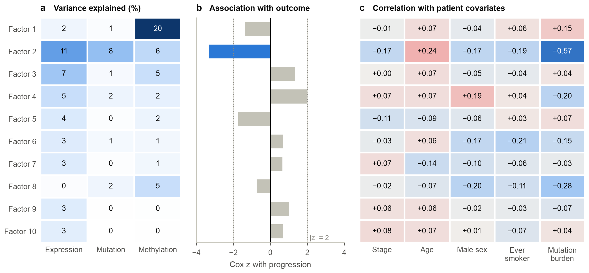

**Figure 6. The ten MOFA factors, fitted on the whole cohort.** (a) Share of each block's variance a factor explains. (b) Association with progression in a single-factor Cox model; dotted lines mark |z| = 2 and the one factor beyond them is blue. (c) Pearson correlation with patient covariates. n = 440 patients, 176 events. The factors here are fitted on all patients to describe them; the factors used for prediction are refitted inside every training fold. Source data: `source_data/fig6_mofa_factors_abc.csv`.

- **Factor 1 is a methylation factor** (20% of methylation variance, almost none elsewhere) and is not associated with outcome.
- **Factor 2 is the only factor associated with progression** (z = −3.34). It is also the only factor shared across all three blocks (11% of expression, 8% of mutation, 6% of methylation variance).
- **Factor 2 tracks mutation burden** (r = −0.57), with weaker links to age (+0.24), smoking (−0.19) and stage (−0.17). Its top genes overlap the proliferation genes. A high score means lower mutation burden, lower proliferation and lower risk.
- **Factor 4 is borderline** (z = +1.98) and correlates with male sex (+0.19).

This explains Part 2: MOFA compresses thousands of features into ten factors, of which one carries the signal, so the survival model has little room to overfit.

### 8.2 Two gene lists, two kinds of biology

Five gene lists were compared.

| List | Genes | Definition |
|:--|--:|:--|
| Prognostic, higher risk | 150 | Top univariate Cox z above +3 |
| Prognostic, protective | 150 | Top univariate Cox z below −3 |
| Kept by the Cox model | 150 | Selected by the penalised Cox model in at least 5 of 25 folds |
| MOFA factor 2 | 50 | Largest weights on factor 2 |
| Proliferation metagene | 8 | MKI67, TOP2A, CDK1, BIRC5, RRM2, CCNB1, AURKA, PLK1 (fixed in advance) |

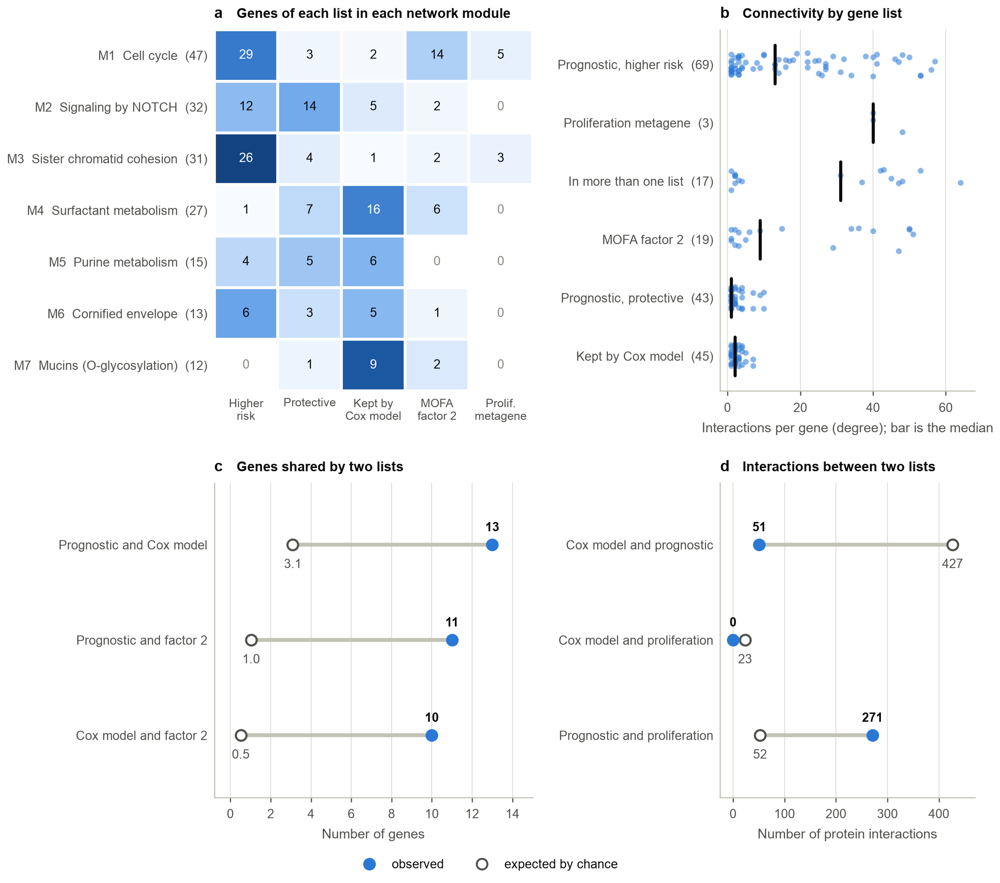

**Figure 7. Genes that are prognostic on their own differ from genes the model keeps.** (a) Number of genes from each list in the seven largest network modules; shading is the share of the module. (b) Protein interactions per gene, by list; the bar is the median. (c) Genes shared by two lists against the number expected by chance. (d) Protein interactions between two lists against the number expected when the list labels are shuffled over the genes of the network; this shuffle does not keep each gene's number of interactions with its label, so the direction is reliable and the size is not. Interactions are STRING links with a combined score of at least 700; numbers in brackets are genes. Source data: `source_data/fig7_biology_a.csv`, `source_data/fig7_biology_b.csv`, `source_data/fig7_biology_c.csv`, `source_data/fig7_biology_d.csv`.

- **Prognostic risk genes are cell-cycle genes.** Modules 1 and 3 (cell cycle, sister chromatid cohesion) hold 55 of them and only 3 model genes. Hubs: CDK1, BUB1, BUB1B, CCNA2, CCNB1.
- **The Cox model keeps differentiation genes.** Module 4 (surfactant metabolism: SFTPB, SFTPC, NKX2-1) holds 16 model genes; module 7 (mucins: MUC5B, MUC16, MUC21) holds 9. The genes selected most often are CLDN2 (20 of 25 folds), MUC21 (19), CPS1, GLB1L3, ANGPTL4 and TCN1 (18 each).
- **The lists share more genes than chance** (13 against 3.1 expected, p = 1.4 × 10⁻⁵) **but are far apart in the protein network**: 51 interactions between them against 427 expected.
- **The proliferation genes are not in the model at all.** No overlap, and no protein interactions between the two lists (23 expected).
- **Factor 2 bridges both.** It shares 11 genes with the prognostic list and 10 with the model list.

A reading consistent with these results: the proliferation signal is strong but redundant, since dozens of tightly correlated genes carry the same information, so a penalised model takes that information from elsewhere and spends its coefficients on lineage and differentiation markers. This is an interpretation, not a tested claim.

**Caution on panel d.** Panel b shows that risk genes have a median of 13 interactions and model genes a median of 2. The shuffling test does not preserve these counts, so the expected value of 427 is inflated by the highly connected cell-cycle genes. The direction of the result is safe; the size is not. A degree-preserving test is the first thing to add.

### 8.3 Network modules

| Module | Genes | Mean Cox z | Top term | Hub genes |
|--:|--:|--:|:--|:--|
| 1 | 47 | +2.79 | Cell cycle | CCNA2, DLGAP5, KIF2C, CENPF, KIF20A, CDC20, TTK, TOP2A |
| 2 | 32 | −0.14 | Signaling by NOTCH | WWP2, LRRK2, TFDP1, AGO1, RUNX1, SMARCA4 |
| 3 | 31 | +2.70 | Sister chromatid cohesion | CDK1, BUB1, BUB1B, CCNB1, PLK1, SGO1 |
| 4 | 27 | −1.35 | Surfactant metabolism | CDH1, SFTPB, SFTPC, NKX2-1, SFTPA1, SFTPD |
| 5 | 15 | +0.50 | Purine metabolism | NT5E, ADCY9, SORD, QPRT, PNP, ADA |
| 6 | 13 | +1.14 | Cornified envelope | ANLN, DIAPH3, PKP2, PKP1, SPRR1B, KRT6A |
| 7 | 12 | −0.38 | Mucin O-glycosylation | MUC16, BPIFB1, MUC5B, MUC6, MSLN, MUC21 |

Modules 1 and 3 are the high-risk modules (mean z near +2.8, enrichment FDR below 10⁻²³). Module 4 is the protective one among the large modules: surfactant genes mark well-differentiated tumours. Smaller modules, all enrichment terms and per-gene centrality are in [RESULTS.md](../RESULTS.md), section 4.

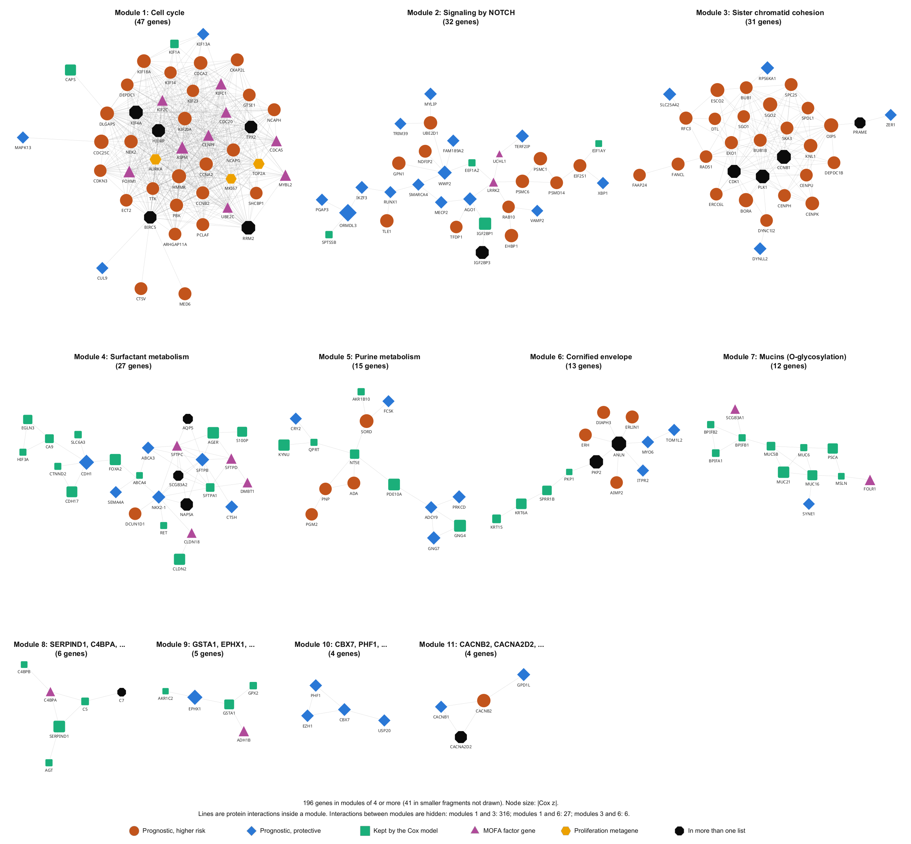

**Figure 8. Protein-interaction network of the gene lists, drawn in Cytoscape.** 196 genes in modules of four or more; node size is |Cox z|. Each gene list has its own colour and node shape. Risk genes (orange circles) fill modules 1 and 3; model genes (green squares) fill modules 4 and 7. Interactions between modules are hidden: 316 between modules 1 and 3, 27 between 1 and 6, 6 between 3 and 6. Modules are Louvain communities named by their top enriched term. The positions of genes inside a module are a layout and carry no meaning. Vector copy: `figures/network_cytoscape_lists.pdf`. Source data: `network/network_nodes.tsv`, `network/network_edges.tsv`, `tables/biology_network_centrality.csv`.

The same network coloured by Cox z: [figures/network_cytoscape_coxz.png](figures/network_cytoscape_coxz.png). Both are also saved as vector PDF. To explore it, open [network/network.cys](network/network.cys) in Cytoscape.

## 9. Robustness checks

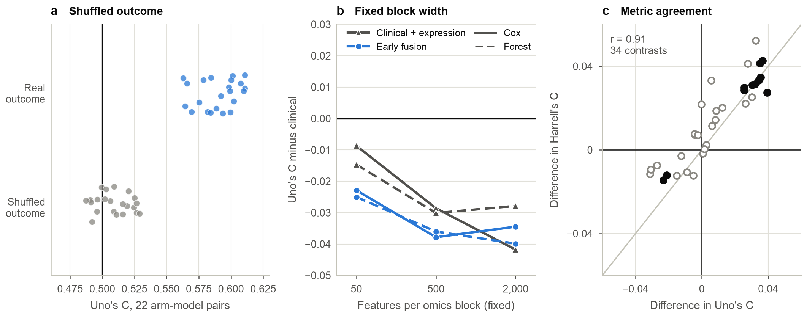

**Figure 9. Three of the four checks.** (a) The same 22 arm-model pairs scored on the real outcome and on a shuffled outcome. (b) Gain over clinical when the width of the omics blocks is fixed instead of tuned. (c) Each of the 34 contrasts under the two concordance metrics; filled points are resolved under Uno's C. All panels: progression-free interval, n = 440, 25 test folds; in (a) the shuffled outcome keeps each patient's event and time together and breaks only their link to the features. Source data: `source_data/fig8_checks_a.csv`, `source_data/fig8_checks_b.csv`, `source_data/fig8_checks_c.csv`.

| Check | Result | Verdict |
|:--|:--|:--|
| Expression rows belong to the right patients | Y-linked genes against recorded sex: r = 0.96 | Pass |
| Expression carries known prognostic biology | Proliferation metagene, no fitting: z = +3.69, Uno's C 0.575 | Pass |
| No leakage: corrupting every test row changes nothing fitted | Identical, all four blocks | Pass |
| Shuffled outcome scores 0.50 | Mean 0.509, range 0.487 to 0.529 over 22 arms | Pass |
| Pairing control is exactly zero | Yes, on both endpoints | Pass |
| No fixed block width puts omics above clinical | Best gain −0.009 (clinical + expression, 50 genes, Cox) | Informative |
| Verdicts agree under Uno's C and Harrell's C | 27 of 34 agree; 5 change sign; differences correlate at r = 0.91 | Informative |

- **The pipeline does not leak.** With a shuffled outcome every arm falls to chance, while the real outcome gives 0.56 to 0.61.
- **The null result in Part 1 is not a tuning artefact.** At 50, 500 or 2,000 features per block, omics never beats clinical, and performance falls as the blocks widen.
- **The signal is there, the model just does not need it.** An eight-gene proliferation score with no fitting reaches 0.575, above the tuned expression-only models (0.502 and 0.546). Expression is prognostic; it is not prognostic beyond stage.
- **Metric dependence is real in places.** Seven verdicts differ between the two metrics, including MOFA − clinical, which is resolved as a gain under Harrell's C with both models but not under Uno's C. The pre-declared primary metric is Uno's C.

## 10. Added after the first run

**Everything in sections 1 to 9 follows the plan that was fixed in `config/config.yaml` before the analysis was run. This section does not.** The two analyses below were added on 24 November 2026, after the results were known. They describe and explore. They add no contrast, change no number above, and no claim in the summary about prediction rests on them. They are in the configuration under `added_after_first_run`, are run by `make survival` and `make factor`, and are checked by `make verify` like every other table.

### 10.1 What the discrimination looks like: survival by predicted risk

A concordance of 0.60 is hard to picture. Here the 440 patients are split into three equal groups by the risk a model gave them, and a Kaplan-Meier curve is drawn for each group. Every risk is out-of-fold: it comes from a model that had not seen the patient. A patient is tested five times in the repeated cross-validation, so the patient's rank inside each test fold is averaged over the five.

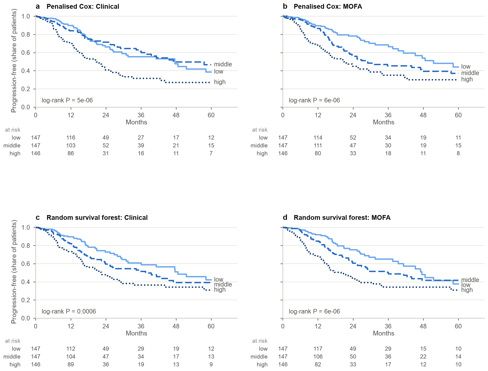

**Figure 10. Progression-free survival of patients grouped by out-of-fold predicted risk.** (a, b) Penalised Cox with the clinical model and with MOFA. (c, d) Random survival forest. n = 440 patients, 176 events within 60 months, in thirds of 147, 147 and 146 patients: low (solid), middle (dashed) and high (dotted) predicted risk. Curves are Kaplan-Meier estimates; the rows under each time axis give the patients still at risk. P is from a log-rank test across the three groups and is a description, not a planned test. Added after the first run. Source data: `source_data/fig9_survival_pfi_abcd.csv`, `source_data/fig9_survival_pfi_summary.csv`.

| Model | Arm | Low risk | Middle | High risk |
|:--|:--|:--|:--|:--|
| Penalised Cox | Clinical | 0.55 (0.44, 0.65) | 0.61 (0.51, 0.70) | 0.32 (0.22, 0.42) |
| Penalised Cox | MOFA | 0.68 (0.57, 0.77) | 0.45 (0.35, 0.55) | 0.35 (0.25, 0.45) |
| Random survival forest | Clinical | 0.61 (0.49, 0.71) | 0.51 (0.41, 0.61) | 0.36 (0.27, 0.46) |
| Random survival forest | MOFA | 0.65 (0.53, 0.74) | 0.50 (0.40, 0.60) | 0.34 (0.24, 0.44) |

*Share of patients progression-free at 36 months, with 95% intervals.*

What it shows:

- **Every model separates the high-risk third from the rest.** About a third of the high-risk group is progression-free at 36 months, against about 60% of the low-risk group.
- **The clinical Cox model does not separate its low and middle thirds**: the middle third does slightly better than the low third (0.61 against 0.55). With MOFA under Cox the three groups are in order.
- **This is not evidence that MOFA is better than the clinical model.** The intervals of neighbouring groups overlap, no test here compares two arms, and the planned comparison says the difference is not resolved (+0.012, section 5). The figure is a picture of the concordances already reported, not a new result.

The same figure for overall survival: [figures/fig9_survival_os.png](figures/fig9_survival_os.png).

### 10.2 What MOFA factor 2 is

Section 8.1 found one factor associated with progression, factor 2, and noted that it follows mutation burden. A factor is one number per patient. This step asks what that number means, using short lists of marker genes for broad biological programmes (they are in the configuration), five driver genes, mutation burden and the clinical covariates.

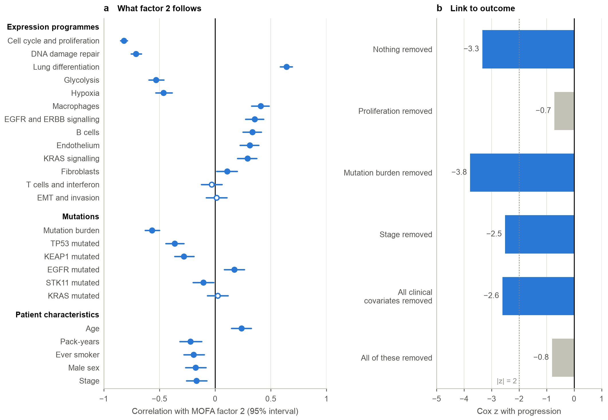

**Figure 11. What MOFA factor 2 follows, and why it is linked to outcome.** (a) Pearson correlation of factor 2 with 13 expression programmes, 6 mutation features and 5 patient characteristics, with 95% intervals; n = 440, fewer where a characteristic is missing. A programme score is the mean standardised expression of 8 to 11 marker genes. Filled markers pass a false-discovery rate of 0.05 over the 24 correlations. (b) Association of factor 2 with progression (Cox score z) alone, and after the part of the factor that a simpler variable explains by linear regression has been removed; bars beyond |z| = 2 are blue. The factor is fitted on all patients. Added after the first run; exploratory. Source data: `source_data/fig10_factor_biology_a.csv`, `source_data/fig10_factor_biology_b.csv`.

| Factor 2 after removing | Share of the factor explained | Cox z with progression |
|:--|:--|:--|
| Nothing | 0% | −3.34 |
| Cell-cycle and proliferation programme | 67% | −0.72 |
| Mutation burden | 32% | −3.78 |
| Stage | 3% | −2.51 |
| All clinical covariates | 15% | −2.61 |
| Proliferation, mutation burden and clinical covariates | 74% | −0.80 |

What it shows:

- **Factor 2 is a proliferation axis.** Its strongest correlation is with the cell-cycle programme (r = −0.82), then DNA damage repair (−0.71). At the other end is lung differentiation, the surfactant genes (+0.64). A high value of the factor means a differentiated, slowly dividing tumour; a low value means a proliferating one. Low values also go with TP53 mutation (−0.36) and a higher mutation burden (−0.57).
- **Its link to outcome is proliferation.** Remove what the nine cell-cycle genes explain and the association with progression falls from z = −3.3 to −0.7. Remove mutation burden instead and it does not fall at all (−3.8). So the correlation with mutation burden noted in section 8.1 is a companion of the factor, not the reason it is prognostic.
- **It is only partly the clinical covariates.** With stage, age, sex and smoking removed the factor is still associated with progression (z = −2.6).
- **This joins the two gene lists of section 8.2.** Genes that are prognostic on their own are cell-cycle genes; genes the Cox model keeps are surfactant and mucin genes. Those are the two ends of this one axis. The lists share few genes and few protein interactions, but they appear to measure the same thing from opposite sides. This reading is consistent with the data here and was not tested.

Read these before using it:

- The programme scores and the factor are both computed from the same expression data, so this says what the factor is. It is not an independent confirmation.
- The marker lists are short and hand-picked. They indicate a programme; they are not validated signatures.
- "Removing" a variable is a straight-line adjustment, and the z values are not corrected for the number of variables tried.

## 11. Relation to my MSc dissertation

This project asks the question of my MSc dissertation again with a different design (University of West London, 2026; the dissertation and its code are not public). The two share the source data and three ideas (fold-internal transforms, the paired patient-level bootstrap, the leakage checks). They do not share patients exactly, models, contrasts or code for the analysis. That makes their agreement informative: it is closer to a replication than to a rerun.

| | Dissertation | This project |
|:--|:--|:--|
| Patients, progression events | 496, 197 | 440, 176 |
| Blocks | Clinical, expression, mutation | Clinical, expression, mutation, methylation |
| Model families | Three | Two |
| Integration methods | Imputation, late fusion and others, six strategies | Early fusion, late fusion, MOFA |
| Comparisons | 106, of which 4 were supported | 34, fixed in advance |
| Clinical covariates alone, Uno's C | 0.586 | 0.598 (0.562, 0.638) |
| All blocks against clinical alone, penalised Cox | −0.033 (−0.056, −0.009) | −0.023 (−0.045, −0.002) |
| The same, random survival forest | −0.031 (−0.075, +0.013) | −0.031 (−0.080, +0.018) |
| Late fusion against the simple alternative, forest | +0.038 (0.007, 0.070), against mean imputation with a block missing | +0.030 (0.002, 0.060), against early fusion |

- **The main answer is the same in both.** Adding every omics block to the clinical covariates lowers concordance by about 0.03, resolved under penalised Cox and in the same direction under the forest.
- **So is the one positive finding about strategy.** Keeping one model per block and combining their risks beats pushing everything through one model, under the forest, by about 0.03.
- **What is new here:** MOFA, the methylation block inside the main analysis, three external cohorts, and a plan fixed before the run in place of 106 comparisons.

The numbers of the dissertation are quoted from it and cannot be checked from this repository.

## 12. Limitations

1. **Effects are small and the cohort is limited.** Differences are 0.01 to 0.04 in concordance, with 176 events. "MOFA beats early fusion" is supported. "MOFA beats clinical" is not.
2. **One run, one seed.** The MOFA advantage has not been repeated with a second cross-validation seed.
3. **Some verdicts depend on the metric.** 27 of 34 agree between Uno's C and Harrell's C.
4. **The network link test overstates its effect size** because it does not preserve each gene's number of interactions.
5. **External results mix two effects:** the integration method, and a clinical baseline with four covariates instead of ten.
6. **Biology is descriptive.** Factors and gene lists come from the whole cohort, not from held-out data, and the interpretation in section 8.2 is not tested.
7. **MOFA uses a Gaussian likelihood for every block**, including the 0/1 mutation features. This keeps the projection of a new patient in closed form but is an approximation.
8. **Patients without all four blocks are excluded.** 56 patients who lack only methylation are left out; MOFA could train on them.
9. **No calibration or decision-curve analysis.** Only discrimination is reported.
10. **Section 10 was added after the results were known.** The survival curves are descriptive and the reading of factor 2 is exploratory; neither is one of the planned comparisons.

## 13. Where everything is

| What | Where |
|:--|:--|
| Complete numbers, generated | [RESULTS.md](../RESULTS.md) |
| Figures (PNG and PDF), workflow (SVG and PDF) | [figures/](figures/) |
| The numbers behind every figure panel | [source_data/](source_data/), one CSV per panel, written by `scripts/07_figures.py` |
| Cohort flow and baseline table | `tables/cohort_flow.csv`, `tables/cohort_characteristics.csv` |
| Arm scores and contrasts | `tables/arms_pfi.csv`, `tables/contrasts_pfi.csv`, and the `_os` versions |
| Fold-level predictions | `tables/cv_pfi_predictions.parquet`, `tables/cv_os_predictions.parquet` |
| External validation | `tables/external_arms.csv`, `tables/external_contrasts.csv` |
| Biology | `tables/biology_*.csv` |
| Added after the first run | `tables/survival_groups_*.csv`, `tables/survival_curves_*.csv`, `tables/biology_factor_associations.csv`, `tables/biology_factor_outcome.csv` |
| Checks | `tables/checks.csv`, `tables/width_sweep.csv`, `tables/cv_pfi_permuted_summary.csv` |
| Network | `network/network.cys` (Cytoscape session), `network/network.graphml`, node and edge tables |
| The plan | `../config/config.yaml` |

| Figure | File | Section |
|:--|:--|:--|
| 1. Workflow | `fig1_workflow.svg` | 2 |
| 2. Prediction | `fig2_prediction_pfi` | 4 |
| 3. Integration and missing blocks | `fig3_integration_pfi` | 5 |
| 4. All contrasts | `fig4_contrasts_pfi` | 5 |
| 5. External validation | `fig5_external` | 6 |
| 6. MOFA factors | `fig6_mofa_factors` | 8.1 |
| 7. Gene lists and network | `fig7_biology` | 8.2 |
| 8. Network (Cytoscape) | `network_cytoscape_lists.png` | 8.3 |
| 9. Checks | `fig8_checks` | 9 |
| Overall survival versions | `fig2_prediction_os`, `fig3_integration_os`, `figS_contrasts_os` | 7 |
| Cohort flow | `figS_cohort_flow` | 3 |
| 10. Survival by predicted risk | `fig9_survival_pfi`, `fig9_survival_os` | 10.1 |
| 11. What factor 2 is | `fig10_factor_biology` | 10.2 |
